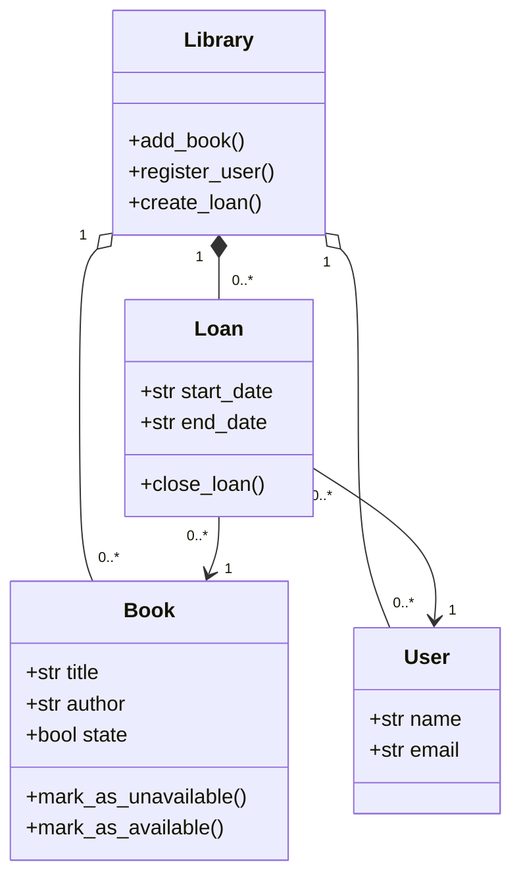
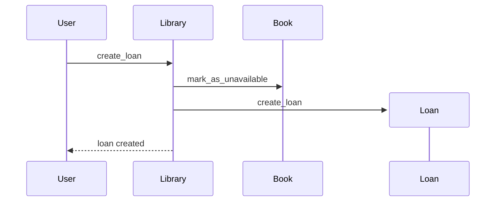

# Holberton School - Software Design and Architecture

Projects about designing software before writing it: UML diagrams and design patterns.

## Projects

| Folder | What is inside |
| --- | --- |
| [uml_intro](uml_intro/) | A class diagram and a sequence diagram for a small library system, written in Mermaid |
| [design_patterns](design_patterns/) | Python examples of three design patterns: Factory, Observer and Decorator |

## uml_intro

The system is a library where users borrow books through loans.

### Class diagram (`0-class_diagram.mmd`)

### Sequence diagram (`1-sequence_diagram.mmd`)

What happens when a user creates a loan:

## design_patterns

| File | Pattern | Idea |
| --- | --- | --- |
| `0-factory.py` | Factory | One place creates objects, so the caller does not choose the exact class |
| `1-observer.py` | Observer | Objects subscribe and get notified when something changes |
| `2-decorator.py` | Decorator | Add new behavior to an object without changing its class |

## How to use

- The `.mmd` files are Mermaid diagrams. GitHub shows them as pictures, and you can also paste them into [mermaid.live](https://mermaid.live).
- Run a pattern example with `python3 file_name.py`.

## Author

Arif Almusharafi - [GitHub](https://github.com/arif-almusharafi)
